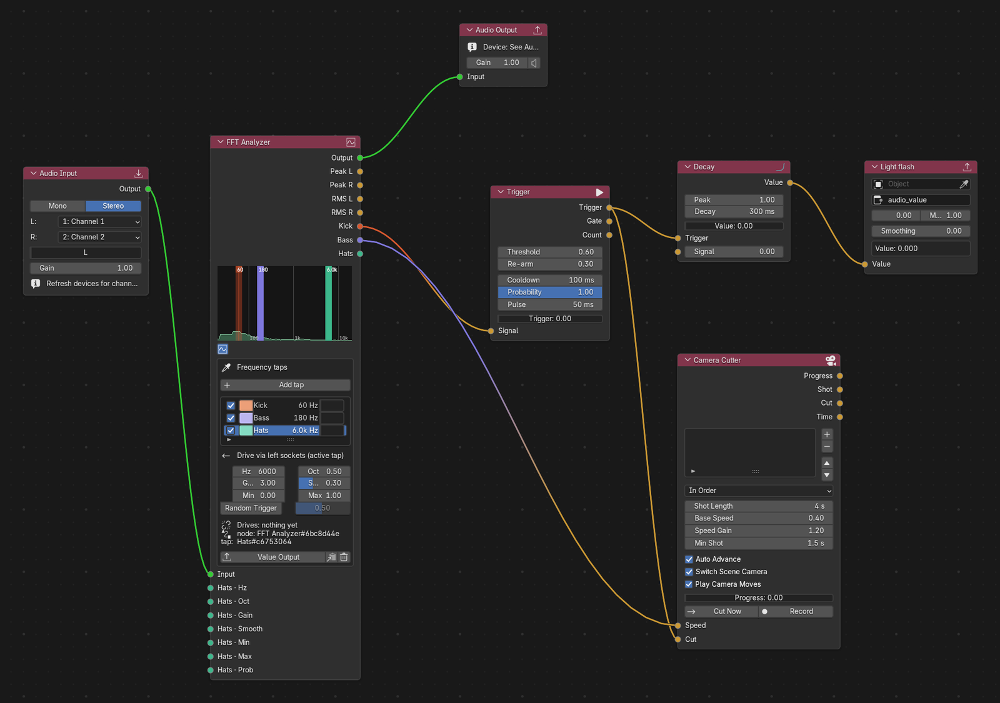
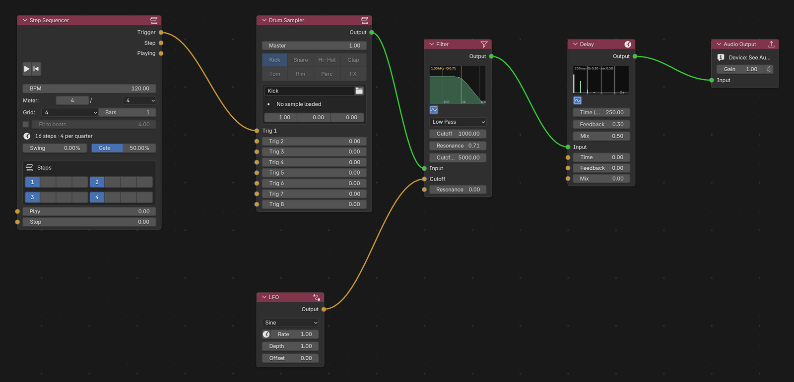

# Audio Nodes for Blender

**Make your Blender scenes react to sound, live.**

Plug in a microphone or audio interface, or play sounds right inside Blender, and connect them to anything in your scene. Lights can flash on every kick drum, the camera can cut on the beat, and objects can pulse with the bass. You build it all by connecting nodes, the same way you work with shader or Geometry Nodes. No coding needed.



<p align="center">
  <a href="../../releases/latest"><b>Download the latest release</b></a> ·
  <a href="#install">Install</a> ·
  <a href="#your-first-audio-reactive-scene">Quick start</a> ·
  <a href="#all-nodes">All nodes</a> ·
  <a href="../../issues">Report a bug</a>
</p>

## What you can do with it

- **React to live sound.** Listen to a microphone, a mixer or any audio interface, and see the sound as a live spectrum inside the node.
- **Pick out parts of the music.** Click on the spectrum to grab just the kick drum, the bass or the hi-hats, and use each one on its own.
- **Drive anything in Blender.** Light strength, colors, object size, shape keys, Geometry Nodes inputs: if Blender can animate it, the sound can move it.
- **Turn hits into actions.** Detect beats, make a flash that fades out, count hits, and cut between cameras in time with the music.
- **Make sound too.** Build a beat with a step sequencer and drum pads, play samples, add filters and echo, and mix up to 8 channels.
- **Use MIDI gear.** Play notes and turn knobs on a MIDI keyboard or controller, or sync to the tempo of your music software.

Everything runs in real time while you work. You don't need to press play on the timeline or render anything.



## Install

**You need:** Blender 5.0 or newer, on a Mac with Apple Silicon (M1 or later).
Windows isn't available as a download yet; see [Building from source](#building-from-source).

1. Download `audio_nodes-<version>-macos-arm64.zip` from the [latest release](../../releases/latest). Don't unzip it.
2. In Blender, open **Edit > Preferences > Add-ons**, click the arrow at the top right and choose **Install from Disk**, then pick the zip.
3. Turn on **Audio Nodes** in the add-on list. The first time, it downloads one small helper library, so give it a moment.
4. The first time the audio starts, macOS asks for microphone access. Click **Allow**, or Audio Nodes won't hear anything.

## Your first audio-reactive scene

Let's make a light flash every time the kick drum hits.

1. **Open the editor.** Change any area of Blender to **Audio Nodes** using the editor type menu at the top left of the area, then click **New**.
2. **Add a sound source.** Press **Shift+A** and add an **Audio Input** node. It listens to your microphone or audio interface. To choose the device, open the sidebar (**N**) and use the **Audio** tab.
3. **See the sound.** Add an **FFT Analyzer** node and connect the green **Output** of Audio Input to its **Input**. Play some music near the mic and the spectrum starts moving. Low sounds are on the left, high sounds on the right.
4. **Grab the kick drum.** Click **Add tap** on the analyzer, then click the low end of the spectrum where the kick drum shows up. A new output appears on the node that follows just that part of the sound.
5. **Connect it to your light.** With the tap selected in the analyzer's list, click the copy icon next to the **Value Output** button. This copies a driver expression. Then, in the Properties editor, right-click your light's **Power**, choose **Add Driver**, and paste into the expression field.

Play some music: the light now pulses with the kick. To make it a sharp flash that fades out, put a **Trigger** node and then a **Decay** node between the tap and the light, as in the screenshot at the top.

> **Tip:** To drive a Geometry Nodes setup, click the **Value Output** button instead. Then pick your object and type the name of the Geometry Nodes input the value should go to.

## All nodes

Press **Shift+A** in the Audio Nodes editor to add any of these.

**Sound in and out**

| Node | What it does |
|---|---|
| Audio Input | Listens to your microphone or audio interface (pick which channels) |
| Audio Output | Plays the result through your speakers or headphones |
| Value Output | Sends a number to a Geometry Nodes input on any object |
| NLA Scrub | Moves an animation forward and back with the sound, e.g. a character dancing to the music |

**Listen and react**

| Node | What it does |
|---|---|
| FFT Analyzer | Shows the live spectrum and lets you pick out frequency bands (kick, bass, hats…) |
| Trigger | Turns a level into clean "hit!" moments, with a threshold and a cooldown |
| Decay | A flash that fades out after each hit, or a smooth follower of the level |
| Accumulator | A value that keeps moving forward, faster when the music is louder |
| Camera Cutter | Cuts between your cameras on the beat and plays their moves at the music's speed |
| Math | Adds, multiplies, clamps and otherwise combines signals |

**Make sound**

| Node | What it does |
|---|---|
| Oscillator | A simple tone generator |
| Sampler | Plays a sound file when triggered |
| Drum Sampler | 8 drum pads (kick, snare, hi-hat…), each with its own sample |
| Step Sequencer | A drum-machine style grid that plays patterns in time |
| LFO | A slow wobble for sweeping filters, volume or anything else |
| ADSR | Shapes a sound or value over time: attack, decay, sustain, release |
| Bang | One button or trigger that fires many things at once |

**Effects**

| Node | What it does |
|---|---|
| Gain | Volume up or down, or mute |
| Filter | Low-pass, high-pass and band-pass filters, with a live curve |
| Delay | Echo, with time, feedback and mix |
| 8ch Mixer | Mixes up to 8 sounds, with a level and pan for each |

**MIDI**

| Node | What it does |
|---|---|
| MIDI Input | Notes from a MIDI keyboard or controller |
| MIDI CC | Knobs and faders on a MIDI controller |
| MIDI Output | Sends notes to other MIDI software or hardware |
| MIDI Clock | Follows the tempo and play/stop of your music software |
| MIDI Monitor | Shows incoming MIDI messages, handy for checking your setup |

## Troubleshooting

**Nothing happens / no sound comes in**
- Check that the header of the Audio Nodes editor says **Engine: Running**. If it doesn't, click the play button next to it.
- macOS may have blocked the microphone. Go to **System Settings > Privacy & Security > Microphone** and turn on Blender.
- Open the sidebar (**N**), go to the **Audio** tab, and check the right input and output devices are selected.

**Bluetooth headphones sound bad or the audio lags**
When an app uses Bluetooth headphones (like AirPods) for both the microphone and the sound, macOS switches them to a low-quality phone-call mode. Use your Mac's built-in microphone, or a separate audio interface, as the input.

**The sound crackles**
Raise the buffer size in **Edit > Preferences > Add-ons > Audio Nodes**, or use fewer nodes.

**Still stuck?** Open **Window > Toggle System Console** to see error messages, then [open an issue](../../issues) and include them.

---

## For developers

### How it works

Audio Nodes has two parts. The Blender add-on (Python) draws the nodes and reads the results. A separate audio engine (C++, built on [JUCE](https://juce.com)) does the actual audio work, so heavy processing never slows Blender's interface down.

```
┌─────────────────────────────────────────────────────────────────┐
│                        Blender Process                          │
│  ┌─────────────────┐  ┌─────────────────┐  ┌─────────────────┐  │
│  │  Node Editor UI │  │  Timer (60fps)  │  │    Drivers      │  │
│  └────────┬────────┘  └────────┬────────┘  └────────┬────────┘  │
│           │                    │                    │           │
│           │ ZeroMQ             │ Shared Memory      │           │
│           │ Commands           │ FFT/Levels         │           │
└───────────┼────────────────────┼────────────────────┼───────────┘
            │                    │                    │
            ▼                    ▼                    │
┌───────────────────────────────────────────────────────────────┐
│                    C++ Audio Engine (JUCE)                     │
│  ┌─────────────┐  ┌─────────────┐  ┌─────────────────────────┐ │
│  │ ZMQ Server  │  │ NodeManager │  │  AudioDeviceManager     │ │
│  └─────────────┘  └─────────────┘  └─────────────────────────┘ │
└───────────────────────────────────────────────────────────────┘
```

Driver expressions use two functions the add-on registers: `audio_tap("<node>", "<tap>")` for an FFT tap and `audio_channel("<name>")` for any other output.

[ARCHITECTURE.md](ARCHITECTURE.md) covers the details: node types, the ZeroMQ command protocol, the shared memory layout and the threading rules.

### Building from source

**Requirements:** CMake 3.22+, a C++20 compiler (Clang 14+ on macOS, Visual Studio 2022 on Windows) and ZeroMQ. JUCE and the other C++ libraries are downloaded by CMake.

macOS (Apple Silicon):
```bash
brew install cmake zeromq
./scripts/build_engine.sh Release
```

Windows (also needs vcpkg: `vcpkg install zeromq:x64-windows`):
```batch
scripts\build_engine.bat Release
```
See [WINDOWS_BUILD.md](WINDOWS_BUILD.md) for the full Windows walkthrough.

Then copy or symlink `blender_addon/` into Blender's add-ons folder as `audio_nodes`, and enable it:
- macOS: `~/Library/Application Support/Blender/5.0/scripts/addons/audio_nodes/`
- Windows: `%APPDATA%\Blender Foundation\Blender\5.0\scripts\addons\audio_nodes\`

To run the engine on its own for debugging:
`"blender_addon/bin/darwin_arm64/AudioNodesEngine.app/Contents/MacOS/Audio Nodes Engine" --zmq-port 5555`

### Contributing

Bug reports, ideas and pull requests are welcome. [CONTRIBUTING.md](CONTRIBUTING.md) explains how to propose a change, build it and run the tests.

## License

Audio Nodes is free software under the [GNU General Public License v3.0](LICENSE).

The audio engine is built on [JUCE](https://juce.com), used under the AGPLv3. See [THIRD_PARTY_NOTICES.md](THIRD_PARTY_NOTICES.md) for all third-party components and their licenses.
